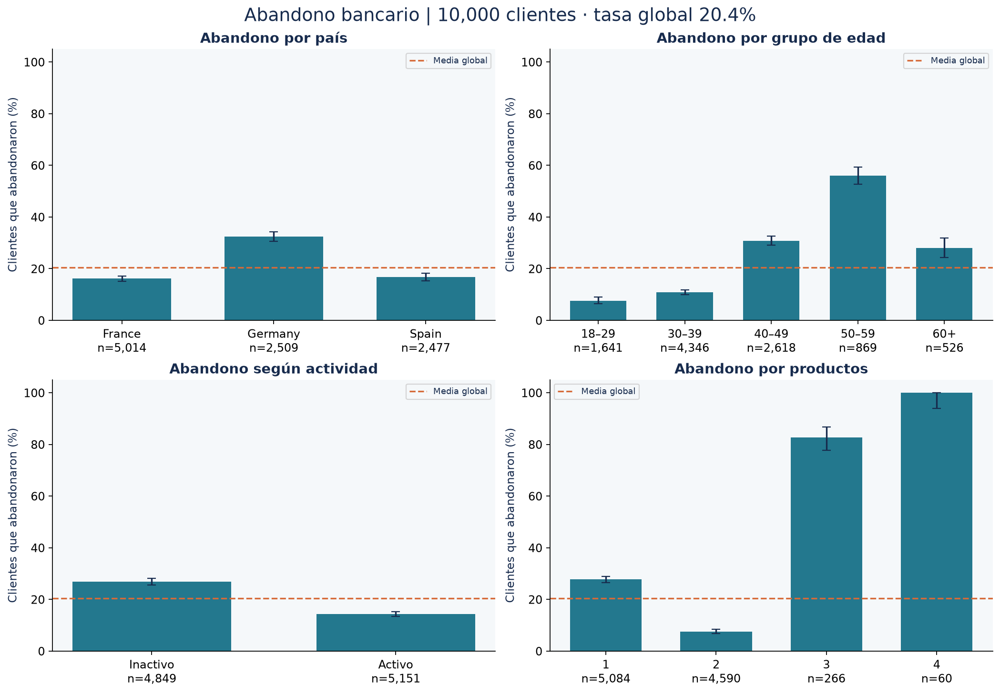

# Abandono bancario: diagnóstico por segmentos

**Autor:** Hector Americo Torres Huamani · [Repositorio](https://github.com/hectortorres26/analisis-abandono-bancario) · [Cuaderno ejecutado](analisis_bancario.ipynb)

Identificar segmentos con mayor proporción de abandono para orientar hipótesis de retención. El análisis describe asociaciones en una muestra educativa de clientes; no estima el efecto causal de una campaña ni construye un sistema de decisiones individuales.



## Resultados verificados

| Indicador | Resultado |
|---|---:|
| Clientes analizados | 10.000 |
| Abandonos observados | 2.037 |
| Tasa global | 20,37 % |
| Intervalo de Wilson del 95 % | 19,59–21,17 % |
| Abandono en Alemania | 32,44 % (n = 2.509) |
| Abandono en Francia | 16,15 % (n = 5.014) |
| Abandono en España | 16,67 % (n = 2.477) |

Alemania presenta una tasa de abandono mayor que Francia y España en esta muestra. La diferencia justifica investigar servicio, composición de clientes y oferta comercial antes de proponer acciones. Los grupos con tres o cuatro productos tienen tasas elevadas, pero tamaños mucho menores: 266 y 60 clientes. El grupo de cuatro productos tiene un 100 % observado, que no implica una probabilidad poblacional conocida del 100 %.

Las cifras proceden de [reports/metrics.json](reports/metrics.json). El cuaderno regenera tablas y figuras desde los datos; no introduce métricas manualmente en el código.

## Herramientas y metodología

Python, pandas, NumPy y Matplotlib, con pruebas `unittest` y cuadernos ejecutados mediante nbclient.

1. Validar columnas, identificadores únicos, ausencia de nulos, valores binarios y dominios numéricos. Los errores detienen la ejecución en vez de modificar registros silenciosamente.
2. Retirar `customer_id` tras verificar la unicidad. No mostrar ni exportar filas individuales.
3. Calcular tasas por país, género, actividad, número de productos y grupos de edad (18–29, 30–39, 40–49, 50–59 y 60+).
4. Presentar denominadores e intervalos de Wilson del 95 %. Suprimir grupos con menos de 30 observaciones.
5. Calcular correlaciones de las variables numéricas originales, incluida la variable de abandono, sin correlacionar una matriz de correlaciones.

## Datos y procedencia

[Bank Customer Churn Dataset, publicado por Gaurav Topre en Kaggle](https://www.kaggle.com/datasets/gauravtopre/bank-customer-churn-dataset). Descarga el archivo `Bank Customer Churn Prediction.csv` y colócalo en `data/`.

Los resultados publicados se ejecutaron con copias públicas descargadas de las fuentes indicadas. No se ha verificado identidad byte a byte con los archivos del Drive del autor. Las huellas SHA-256 en [data/README.md](data/README.md) y `reports/metrics.json` identifican las entradas exactas. Los datasets se excluyen de Git; consulta las condiciones de cada fuente antes de reutilizarlos o redistribuirlos.

| Campo | Uso |
|---|---|
| `customer_id` | Validación de unicidad; excluido del análisis |
| `churn` | Indicador de abandono: 1 = abandono, 0 = permanencia |
| `country`, `gender` | Segmentación categórica |
| `age`, `tenure` | Edad y antigüedad declaradas en el dataset |
| `products_number`, `credit_card`, `active_member` | Relación comercial; dos últimos indicadores binarios |
| `credit_score`, `balance`, `estimated_salary` | Perfil numérico; no se publican registros individuales |

## Reproducir el proyecto

```powershell
git clone https://github.com/hectortorres26/analisis-abandono-bancario.git
cd analisis-abandono-bancario
python -m venv .venv
.\.venv\Scripts\python.exe -m pip install -r requirements.txt
# Coloca los archivos descritos en «Datos y procedencia» dentro de data/.
.\.venv\Scripts\python.exe -m unittest discover -s tests -v
.\.venv\Scripts\python.exe -m src.analysis
.\.venv\Scripts\python.exe scripts/execute_notebook.py
```

En macOS/Linux utiliza `.venv/bin/python` en lugar de `.\.venv\Scripts\python.exe`.
La ejecución validada utiliza Python 3.11.9; las versiones están fijadas en `requirements.txt`.
`python -m src.analysis --help` permite cambiar rutas de entrada y salida.
El último comando ejecuta el cuaderno en un kernel nuevo y guarda sus salidas; no requiere instalar la interfaz de Jupyter.
Para explorarlo interactivamente, abre el archivo `.ipynb` en VS Code con soporte de Jupyter y selecciona el entorno `.venv`.


## Estructura

| Ruta | Contenido |
|---|---|
| `analisis_bancario.ipynb` | Problema, metodología, ejecución y conclusiones |
| `src/analysis.py` | Validación, análisis y generación de resultados |
| `src/common.py` | Estilo visual, serialización y trazabilidad |
| `tests/test_analysis.py` | Regresiones de los fallos técnicos corregidos |
| `data/README.md` | Entradas requeridas y huellas SHA-256 |
| `reports/` | Métricas JSON, tablas agregadas CSV y figuras PNG |
| `scripts/execute_notebook.py` | Ejecución reproducible con kernel limpio |
| `DESCRIPCION_PORTAFOLIO.md` | Texto profesional listo para el portafolio |

## Alcance y limitaciones

Los intervalos suponen observaciones independientes y no corrigen comparaciones múltiples. La muestra no acredita representatividad de un banco real. Las diferencias pueden depender de variables no observadas; país y edad no deben convertirse automáticamente en criterios de intervención. Las tablas públicas son agregadas, pero eso no constituye una garantía formal de anonimización. No se ha medido ahorro económico ni reducción real del abandono.

## Historial y correcciones

El [archivo de la versión inicial](https://github.com/hectortorres26/analisis-abandono-bancario/blob/f527704abd53c9d7a21cb0a651236eb891b827c8/analisis_bancario.ipynb) permanece en el historial.
Los cambios se registran en commits separados para código, cuaderno/resultados y documentación, sin reescribir la versión inicial.
Consulta [CHANGELOG.md](CHANGELOG.md) para relacionar los problemas originales con las correcciones.

Referencia metodológica: [prevención de fuga de información en scikit-learn](https://scikit-learn.org/stable/common_pitfalls.html).
